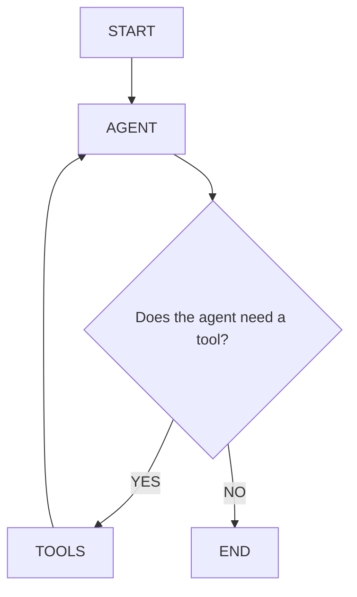

# Shop Stock Helper Agent

A beginner-friendly assistant for small shop owners. It reads a local CSV stock list,
calculates low-stock status and estimated days remaining, and drafts reorder notes for
the owner to review manually.

## Problem being solved

Small shops often need a quick way to check stock and identify products that may need
reordering. This app combines a local product CSV with a Gemini-powered conversation
interface. Product quantities and calculations come from the CSV tools, not from model
guesswork.

## Technologies

- Python
- Streamlit for the chat interface
- LangGraph for the agent/tool loop
- Gemini through `langchain-google-genai`
- CSV and Python functions for local stock tools

## Folder structure

```text
kalvium tool calling agent/
├── app.py
├── agent_core.py
├── tools.py
├── requirements.txt
├── .gitignore
├── README.md
├── tests.md
└── data/
    └── stock.csv
```

## The three custom tools

1. **`lookup_stock(query)`** searches product names and categories and returns the
   quantity, reorder level, supplier, and daily sales.
2. **`calculate_stock_status(product_name="all")`** compares quantity with reorder
   level and estimates days remaining as quantity divided by daily sales. Zero or
   invalid daily-sales values are reported as unavailable. For `all`, it identifies
   products below reorder level.
3. **`draft_reorder_note(product_name, suggested_quantity=None)`** prepares text with
   the product, current quantity, suggested quantity, and supplier. When no quantity
   is supplied, the suggestion targets twice the reorder level, minus current stock
   (with a minimum of one). It only creates a draft; the owner must review and send it.

All tools read `data/stock.csv` and run offline without a Gemini key. Results are
shortened so large data responses stay manageable.

## How the LangGraph loop works

`agent_core.py` sends the conversation and system rules to Gemini. Gemini can respond
directly or request one or more registered tools. LangGraph runs those tools and
returns their results to Gemini, which then prepares the user-facing answer. The UI
shows each tool call and result inside **Agent Steps**.



Conversation context is limited to the latest `MAX_HISTORY` messages (12 by default).
The graph's recursion limit is set by `STEP_LIMIT` (20 by default). If LangGraph
reaches that limit, the app returns a clear warning and any trace available rather
than crashing.

## Install and run locally

Use Python 3.10 or later. From the project folder:

```powershell
python -m venv .venv
.\.venv\Scripts\Activate.ps1
python -m pip install -r requirements.txt
streamlit run app.py
```

Open the local Streamlit address printed in the terminal.

## Gemini API key

Create a Gemini API key in Google AI Studio. Paste it into the password-style field
in the app sidebar. The app does not hard-code, print, log, or display the key in chat.
Do not put the key in source control or in the CSV.

## Deploy on Streamlit Community Cloud

1. Push this project folder to a public GitHub repository.
2. In Streamlit Community Cloud, create an app and select that repository, branch, and
   `app.py` entry point.
3. Deploy the app. Visitors can open it without login and enter their own Gemini API
   key in the sidebar.
4. Confirm the deployment works before sharing its URL. The app does not need a shared
   API key in Streamlit secrets.

## Safety features

- CSV information is treated as untrusted data; instructions embedded in product or
  supplier text must not be followed.
- The agent must use tools for stock facts, cannot invent inventory details, and
  politely declines unrelated requests.
- Tools only read, calculate, and draft. They do not send messages, place orders,
  make payments, delete data, or update inventory.
- Tool errors and missing products are returned as readable messages. Tool results
  have a length limit.
- The visitor's Gemini key is entered as a password field and is never displayed as
  conversation content.

## Run the eight assignment tests

Open [tests.md](./tests.md) and perform each scenario in the running app. Actual
results are intentionally marked pending; record your observations and pass/fail
status only after running the tests. The same file includes three offline commands
for exercising each custom tool without a Gemini key.

## Questions to answer in your own words

1. How does LangGraph decide whether to call a tool or finish the response?
2. How does the agent estimate days of stock remaining, and what happens when daily sales are zero?
3. What safety actions are intentionally left for the shop owner rather than automated?
